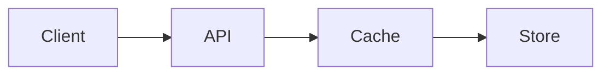
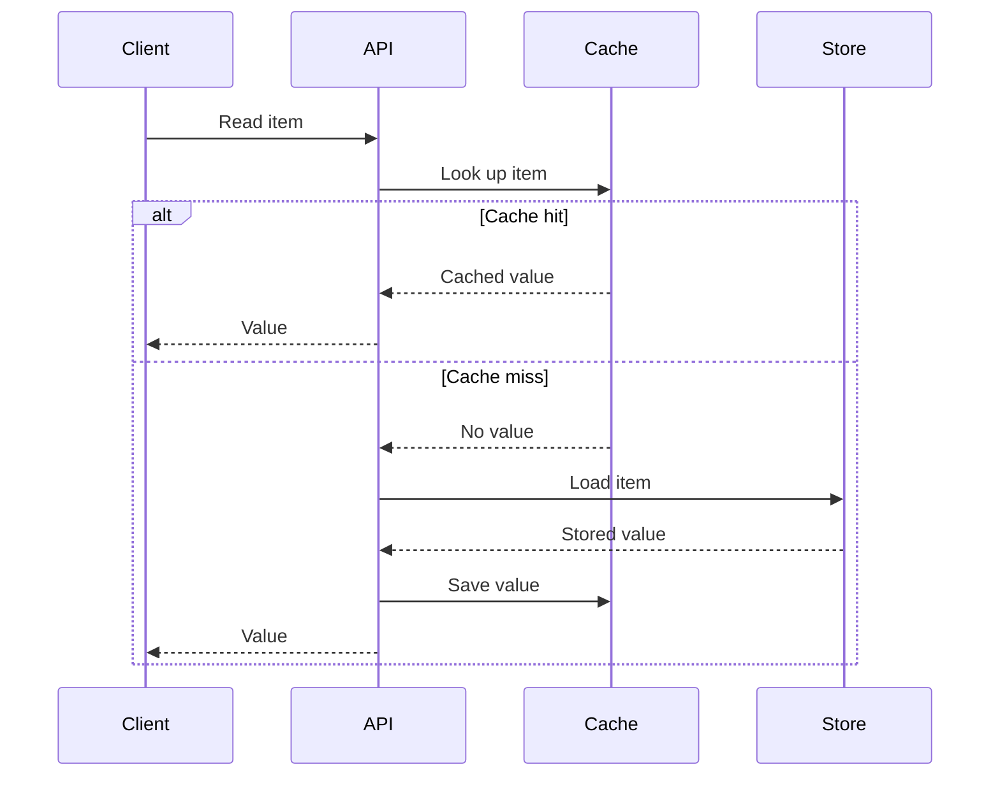
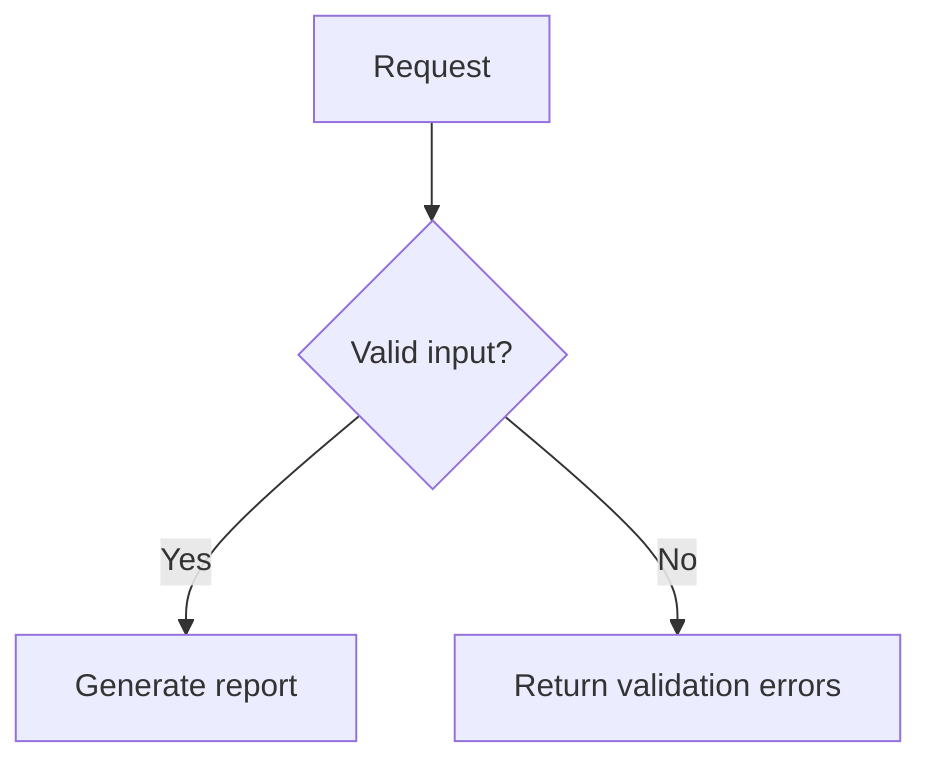

# Mermaid: explain a relationship and preserve its meaning

## Choose the model before drawing

| Question | Form | What must stay visible |
|---|---|---|
| Where does data go? | Flowchart | Transformations, outputs and boundaries |
| Who waits for whom? | Sequence | Message order, alternatives and returns |
| When can this entity change? | State diagram | States and transition conditions |
| How do records relate? | Entity relationship diagram | Cardinality and keys |

A component list does not automatically need a diagram. Draw the smallest view
that exposes the relationship the reader would otherwise reconstruct. Keep one
level of abstraction: user-facing steps, services, or functions. Include lower-level
detail only where it explains the consequential edge.

## Label the semantics

Nodes name concrete actors, states or transformations. Edges express the relevant
data (`validated rows`), action (`invalidate cache`), or condition (`cache miss`).
“Then” rarely explains anything; a meaningful verb often does. Branches need labels
that distinguish their outcomes. Use the same names in the code, diagram and prose.
Short labels help, but preserve a qualifier that changes the meaning.

Use layout to expose the main path. LR often suits a short pipeline; TD gives a
branching flow more vertical room. Participant order controls a sequence's reading
order. Group only where a boundary matters. If a renderer produces long crossings,
wide whitespace or tiny text, change the grouping, direction or scope before adding
styling directives. Node count alone cannot establish readability.

## Worked example: a sequence reveals the bypass

Suppose the supplied implementation checks a cache, returns immediately on a hit,
and loads from the store only on a miss. This diagram loses the branch:

It suggests that every request visits every component. A useful caption and
sequence make the actual condition explicit:

**A cache hit returns immediately; only a miss loads and caches the stored value.**

This invented example assumes the save occurs before returning. If the real save
runs in the background, show that ordering instead. Do not imply an acknowledgement,
transaction, durability guarantee or error recovery absent from the evidence.

The four-participant sequence suits a normal documentation column. At a phone
width its labels become too small when scaled to fit. If the reader only needs
to know which path visits the store, use this compact comparison instead:

| Cache result | API behavior |
|---|---|
| Hit | Return the cached value; skip the store. |
| Miss | Load from the store, save in the cache, then return the value. |

If message ordering is essential, split the sequence into smaller views with
explicit starting conditions, or offer a readable full-size diagram alongside
the prose. A diagram that technically fits can still be unreadable.

For a flowchart decision, concise conditions are often enough:

## Portable syntax and accessibility

Use a `mermaid` fence and stable IDs separate from visible labels. Quote flowchart
labels with punctuation, for example `Validate["Validate (strict mode)"]`. Avoid
lowercase `end` as a flowchart ID or label; sequence `end` is a required block
terminator. Leave spacing around edges to avoid accidentally creating special
arrowheads. Put `%%` comments on their own lines. Use short labels; check support
before relying on HTML breaks, markdown strings, icons, or newer shapes.

GitHub and a local renderer may use different Mermaid versions. Check the host's
supported version before adopting newer syntax. Default colors are a good starting
point; custom colors require light/dark inspection and redundant labels. Add
`accTitle` and `accDescr` where supported, plus a nearby prose takeaway for hosts
that do not expose the accessible description.

## Verify three separate things

1. **Meaning:** trace each branch against the source. Check ordering, direction,
   waits, bypasses, boundaries, return values and the absence of invented edges.
2. **Syntax:** parse with the supported renderer. If the project's Mermaid CLI is
   installed, `mmdc -i diagram.mmd -o diagram.svg` renders one source file. For theme
   checks, render separate outputs with `-t default` and `-t dark`.
3. **Appearance:** inspect the output at intended page width. Labels must remain
   legible; important paths must not disappear into crossings or clipping. A parse
   pass does not establish visual quality or GitHub compatibility.

Use local tooling for private diagrams. An online editor uploads the supplied
content; do not treat it as an automatic verification step. If no renderer is
available, report source inspection honestly instead of claiming a render pass.

Syntax basis: [flowcharts](https://mermaid.js.org/syntax/flowchart.html),
[sequences](https://mermaid.js.org/syntax/sequenceDiagram.html),
[accessibility](https://mermaid.js.org/config/accessibility.html),
[CLI](https://github.com/mermaid-js/mermaid-cli), and
[GitHub support](https://docs.github.com/en/get-started/writing-on-github/working-with-advanced-formatting/creating-diagrams).
