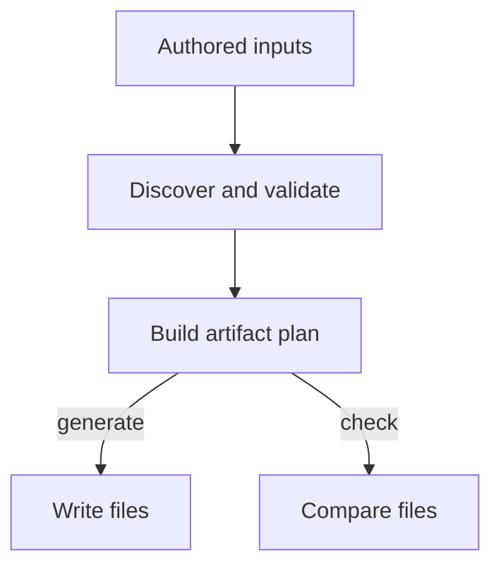

# How sources become installable artifacts

skillsmith reads authored skills and plugin configuration, builds an artifact
plan, and either writes that plan or checks the existing files against it.
Contributors change the sources; the compiler owns the distributions.

## The three invariants

1. **Authored sources own generated content.** Change `skills/`, `agents/`,
   `commands/`, `hooks/`, `mcp/`, or `skillsmith.toml`, then regenerate.
2. **Writing and checking share one plan.** `generate` and `check` use the same
   `GeneratePlan`, so the drift gate compares the bytes the writer would emit.
3. **Host compatibility is explicit.** Schema layers and target adapters describe
   supported surfaces. Claude limits and known hook/tool names live in
   [`constants.ts`](../packages/core/src/constants.ts); host adapters implement
   their own packaging and runtime constraints.

## The pipeline

Both commands build the same plan from source inputs. Only `generate` writes it;
`check` reports differences without applying them.



`generate` gates on plan diagnostics; run `validate --strict` separately for the
full source-quality and security gate, including warnings. Model evaluations are
separate commands; they do not run as part of generation or drift checking.

| Stage | Responsibility |
|---|---|
| [Discover](../packages/core/src/discovery.ts) | Inventory source files and parse skill and agent frontmatter |
| [Validate](../packages/core/src/validate.ts) | Check content, build script inventories, and resolve composition edges |
| [Plan](../packages/core/src/generate.ts) | Render manifests and docs; schedule resource copies |
| [Check](../packages/core/src/check.ts) | Report missing, modified and stale generated files |

`buildPlan()` performs no filesystem I/O. It returns rendered content plus a
destination-keyed copy map, allowing one source resource to ship to several hosts.
`writePlan()` applies that plan. Discovery inventories files; validation and checks
also read the contents they need.

## Why determinism is load-bearing

The drift gate depends on reproducible output. Generation uses explicit JSON field
order, stable collection ordering, LF line endings and final newlines. A changed
artifact must be explainable by changed inputs or generator code.

Recorded routing results are inputs to the catalog. They live in
`.skillsmith/eval-results.json` and change when evaluations are rerun; generating
the same report does not repeat the model calls. Hashes tie each routing result to
its description, cases and catalog context. The
[routing guide](evals.md) explains invalidation and aggregation.

## Generated ownership

These are selected generated paths, not the full repository inventory:

```text
plugins/                  # Claude Code bundles
catalog/                  # Skill catalog
dist/
├── codex/                # Native Codex plugins and marketplace
└── generic/              # Portable skill trees
.claude-plugin/           # Claude marketplace
.skillsmith/schemas/      # Editor JSON schemas
.codex/skills/            # Codex project skills
.opencode/skills/         # OpenCode project skills
```

`check` reports files inside these owned roots that the plan no longer contains,
including hidden manifests. It also compares all planned outputs. The README
opts into partial ownership with `<!-- skillsmith:start -->` and
`<!-- skillsmith:end -->`: the generator owns the counts and plugin chooser
between those markers; the surrounding prose stays authored.

[Target adapters](../packages/core/src/targets.ts) append artifacts to the same
plan. They normalize portable frontmatter and retain resources and attribution.
Native Codex bundles include supported skills and configured MCP; Claude agents,
commands and hooks remain in the Claude distribution. See
[plugin compatibility](plugins.md#what-ships-to-each-host).

## Diagnostics and schema layers

A [diagnostic](../packages/core/src/diagnostics.ts) carries a rule ID, source
location, severity and applicable profiles. The profiles are `standard`,
`claude-code` and `cowork`; they allow a field to be valid for one surface and
rejected by another. `forProfile()` selects the applicable findings. See the
[rule reference](validation-rules.md) for each failure and its fix.

Frontmatter passes through the
[Agent Skills schema](../packages/core/src/schemas/agent-skills-standard.ts) and
[Claude extension schema](../packages/core/src/schemas/claude-code-frontmatter.ts).
Host-owned surfaces warn on unknown fields. skillsmith-owned configuration and
evaluation cases reject unknown keys. Generated JSON schemas supply editor
validation from those same definitions.

## Model evaluations

Two commands answer different questions:

| Command | Question |
|---|---|
| `eval` | Does the model select the intended skill from the catalog? |
| `effectiveness` | Does using the skill improve the answer on these tasks? |

The CLI defaults to Astra through a Codex ChatGPT subscription. The
[subscription adapter](../packages/cli/src/codex-runner.ts) verifies ChatGPT
authentication, removes API credentials from child environments and creates fresh
ephemeral sessions with structured output. Text runs disable host skills, plugins
and tools; tool events, incomplete turns and malformed responses fail the run.

Core owns vote aggregation, arm comparisons and provenance through injected judge
and runner interfaces. It does not require Codex. The
[effectiveness guide](effectiveness.md) describes isolation, custom runners and
what text benchmarks cannot establish.

## Where to make a change

| Change | Start here |
|---|---|
| Skill behavior or supporting examples | `skills/<category>/<name>/` |
| Plugin membership, versions or policy | `skillsmith.toml` |
| Validation, generation or scoring rules | [Core package](../packages/core/README.md) |
| Commands, authentication or process handling | [CLI package](../packages/cli/README.md) |
| Regression coverage | `packages/core/test/` and `packages/cli/test/` |

[CI](../.github/workflows/ci.yml) runs strict validation, drift and version checks,
tests, and both package typechecks. The manually dispatched
[evaluation workflow](../.github/workflows/eval.yml) tests evaluation fixtures
offline. Subscription model runs happen locally.

Version guard compares shipped bytes in both `plugins/<name>/` and
`dist/codex/plugins/<name>/` with an explicit Git baseline. It normalizes manifest
versions before hashing. A content change requires a version bump; a version bump
requires its changelog entry. CI uses the PR base or pre-push commit, and fails
when a required baseline cannot be resolved.
